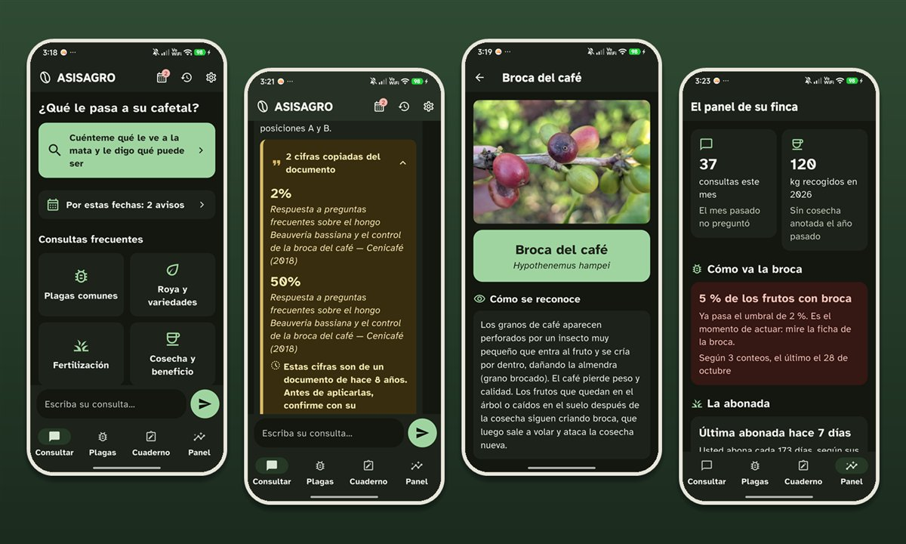
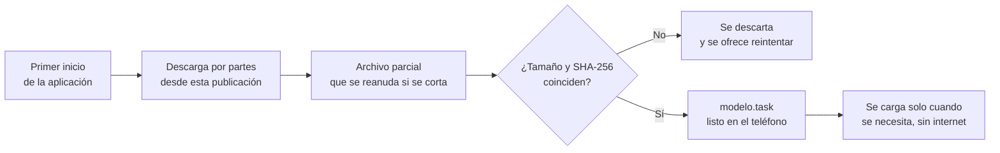

<div align="center">


<br>

# Modelo de ASISAGRO

**Los pesos de Gemma 3 1B que la aplicación ASISAGRO descarga en su primer inicio**
**para responder sin conexión, dentro del teléfono**

<br>

[](https://github.com/Juancho0612/asisagro-modelo/releases/download/gemma3-1b-q4-ekv1280/modelo.task)
[](https://github.com/Juancho0612/asisagro-modelo/releases/tag/gemma3-1b-q4-ekv1280)


<br>



</div>

---

## Qué es este repositorio

Aquí vive **una sola cosa**: el archivo de pesos del modelo de lenguaje que ASISAGRO descarga la primera vez que se abre. No contiene código de la aplicación.

**ASISAGRO** es un asistente técnico agrario que responde preguntas sobre el café **sin necesitar internet**, para caficultores colombianos. Un modelo de lenguaje corre dentro del propio teléfono y redacta las respuestas apoyándose en documentos de Cenicafé. Es el trabajo de grado de Bernardo Elías Ramírez Avendaño y Juan David Alzate Zapata, Ingeniería en Software, Tecnológico de Antioquia, 2026.

Este repositorio existe para que el instalador de la aplicación pese poco y el modelo, que es lo grande, se baje una sola vez, con conexión, y se quede en el teléfono.

---

## Qué hay publicado

| Publicación | Archivo | Tamaño | SHA-256 |
|---|---|---|---|
| [`gemma3-1b-q4-ekv1280`](https://github.com/Juancho0612/asisagro-modelo/releases/tag/gemma3-1b-q4-ekv1280) | `modelo.task` | 722 004 982 bytes (689 MB) | `ec839570e236d56eae042b56b06f7114ebab4899f539d93fd668b1a16432adab` |

**Descarga directa**

```text
https://github.com/Juancho0612/asisagro-modelo/releases/download/gemma3-1b-q4-ekv1280/modelo.task
```

La dirección acepta descargas parciales (cabecera `Range`), que es lo que permite a la aplicación reanudar una descarga cortada en vez de empezar de cero.

---

## Ficha técnica del modelo

| | |
|---|---|
| **Modelo base** | Gemma 3 1B, versión ajustada para instrucciones (IT) |
| **Desarrollador** | Google |
| **Origen del archivo** | [`litert-community/Gemma3-1B-IT`](https://huggingface.co/litert-community/Gemma3-1B-IT), sin modificar |
| **Formato** | `.task` de MediaPipe LLM Inference |
| **Cuantización** | int4 por bloques de 32 (`q4_block32`), para que quepa en un teléfono de gama media |
| **Ventana de contexto** | 1280 (`ekv1280`), con prellenado múltiple |
| **Archivo original** | `gemma3-1b-it-int4-multi-prefill-seq_q4_block32_ekv1280.task`, publicado aquí como `modelo.task` |
| **Reentrenamiento** | Ninguno. ASISAGRO usa el modelo tal cual |

---

## Verificar que el archivo es el correcto

La aplicación lo comprueba sola antes de usarlo, pero cualquiera puede repetir la verificación.

**Windows (PowerShell)**

```powershell
Get-FileHash .\modelo.task -Algorithm SHA256
```

**Linux o macOS**

```bash
sha256sum modelo.task
```

```bash
shasum -a 256 modelo.task
```

El resultado debe ser exactamente `ec839570e236d56eae042b56b06f7114ebab4899f539d93fd668b1a16432adab` y el tamaño, 722 004 982 bytes. Si cambia una sola letra, el archivo no es este.

---

## Cómo lo usa ASISAGRO



1. **Se descarga una sola vez.** En el primer inicio, la aplicación muestra el peso (unos 689 MB), recomienda wifi y avanza con una barra.
2. **Se puede cortar.** El avance se guarda en un archivo parcial y, al reintentar, continúa desde el último byte descargado.
3. **Se verifica antes de usarse.** Se comparan el tamaño y el resumen SHA-256 con los que la aplicación lleva escritos. Si no coinciden, el archivo se descarta.
4. **No se carga al arrancar.** El modelo ocupa memoria, así que se carga por detrás cuando hace falta y se suelta al pasar a segundo plano.
5. **Después, sin conexión.** Con el archivo en el teléfono, la aplicación responde sin internet.

---

## Qué papel cumple el modelo en ASISAGRO

**El modelo no decide, redacta.** Primero la aplicación busca en un corpus curado de Cenicafé los fragmentos que responden la pregunta. Después el modelo los explica con palabras sencillas. Y como un modelo de este tamaño puede equivocarse:

- **Las cifras no pasan por el modelo.** Las cantidades se copian literales del documento y se muestran en un bloque citado aparte.
- **Cada oración se contrasta con los documentos.** La que no tiene respaldo se retira antes de llegar al agricultor.
- **Si no hay respaldo, la respuesta lo dice** con un aviso visible y remite al extensionista.

Gemma 3 1B es el modelo de demostración del proyecto. La comparación medida con otros candidatos sigue pendiente.

---

## Licencia

El archivo es una compilación de Gemma publicada por Google. Gemma se entrega bajo los [**Términos de uso de Gemma**](https://ai.google.dev/gemma/terms) y está sujeta a la [**Política de usos prohibidos de Gemma**](https://ai.google.dev/gemma/prohibited_use_policy). **Al descargarlo o usarlo se aceptan esos términos.** Ver [NOTICE.md](NOTICE.md).

ASISAGRO no modifica el modelo ni lo reentrena: lo usa tal cual, dentro de un teléfono, para redactar respuestas sobre el cultivo de café a partir de documentos de Cenicafé.

---

<div align="center">

**ASISAGRO** · Trabajo de grado · Ingeniería en Software
Tecnológico de Antioquia, Institución Universitaria (TdeA) · 2026

Autores: Bernardo Elías Ramírez Avendaño y Juan David Alzate Zapata
Directora: Silvana Lorena Vallejo Córdoba


</div>
